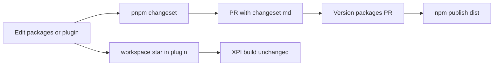

# Workspace package publish (Changesets)

## Goal

Automate versioning and npm publish for the nine `@janbaykara/*` packages under `[packages/](packages/)`, without changing how Syllabus develops them (`workspace:*` + esbuild inlines `src/`).

Prerequisite (manual, outside the PR): create/claim the `@janbaykara` npm org and add a repo secret `NPM_TOKEN` with publish rights. Until that exists, CI can still open Version PRs; publish will fail until the token is set.

## Design choices (fixed)

- **Local DX unchanged:** each package keeps `exports` pointing at `./src/...` (and CSS for tailwind-theme) so `[zotero-plugin.config.ts](zotero-plugin.config.ts)` / esbuild keep bundling TypeScript.
- **npm tarball uses `dist/`:** set `publishConfig.exports` / `publishConfig.main` / `publishConfig.types` (and `files`) so `pnpm publish` packs compiled JS + `.d.ts`. CSS-only `[zotero-tailwind-theme](packages/zotero-tailwind-theme/)` ships `theme.css` as today (no compile step).
- **Versioning:** Changesets with **independent** versions; ignore root plugin, `website/`, and `cloud/`.
- **Release flow:** Changesets GitHub Action opens a Version packages PR; merge publishes to npm (`access: public` for the scoped packages).




## 1. Per-package build

- Add `[packages/tsconfig.base.json](packages/tsconfig.base.json)` (ESM, `declaration`, `outDir: dist`, `rootDir: src`; `skipLibCheck` as needed for `zotero-types`).
- Each TS package gets `tsconfig.build.json` + `"build": "tsc -p tsconfig.build.json"` and `"files": ["dist", "README.md"]`.
- Multi-entry packages (`[zotero-dnd](packages/zotero-dnd/)`, `[zotero-os-file-drop](packages/zotero-os-file-drop/)`): emit both `.` and `./preact` into `dist/` and mirror that in `publishConfig.exports`.
- Root script: `"packages:build": "pnpm -r --filter './packages/*' run build"` (tailwind-theme `build` is a no-op).
- Add `dist/` to package `.gitignore`.
- `"prepublishOnly": "pnpm run build"` on each publishable TS package.

Example `publishConfig` shape (TS package):

```json
"exports": { ".": "./src/index.ts" },
"publishConfig": {
  "access": "public",
  "main": "./dist/index.js",
  "types": "./dist/index.d.ts",
  "exports": {
    ".": {
      "types": "./dist/index.d.ts",
      "import": "./dist/index.js"
    }
  }
}
```

## 2. Changesets

- Dev-dep `@changesets/cli` at repo root.
- `[.changeset/config.json](.changeset/config.json)`: `access: public`, `baseBranch: main`, `updateInternalDependencies: patch`, ignore the root plugin package name (`zotero-syllabus`); website/cloud stay `private: true`.
- Root scripts: `changeset`, `changeset:version`, `changeset:publish` (`packages:build && changeset publish`).
- Habit: when a PR changes public package API/behaviour, run `pnpm changeset` and commit the file (plugin-only PRs need none).

## 3. CI

- New `[.github/workflows/packages.yml](.github/workflows/packages.yml)` using `changesets/action`:
  - Trigger: push to `main` (path filter `packages/**`, `.changeset/**`, workflow file).
  - Flow: install → `pnpm packages:build` → changesets action with publish/version scripts and `NPM_TOKEN`.
- Keep existing XPI `[release.yml](.github/workflows/release.yml)` separate.

## 4. Docs (same change)

- `[packages/README.md](packages/README.md)`: changeset habit, `workspace:*` for Syllabus, publish flow.
- `[doc/TECHNICAL.md](doc/TECHNICAL.md)` workspace-packages section: build + Changesets + `NPM_TOKEN`.
- `[website/src/content/docs/developers/packages.md](website/src/content/docs/developers/packages.md)`: short Publishing note.
- Typedoc for packages stays out of this plan.

## 5. First publish (after merge + token)

- Set `NPM_TOKEN`, land an initial changeset for packages to ship, merge the Version PR, confirm tarballs contain `dist/`.

## Out of scope

- Publishing the root plugin as an npm package.
- Package typedoc on the docs site.
- Changing plugin import paths or dropping `workspace:*`.

