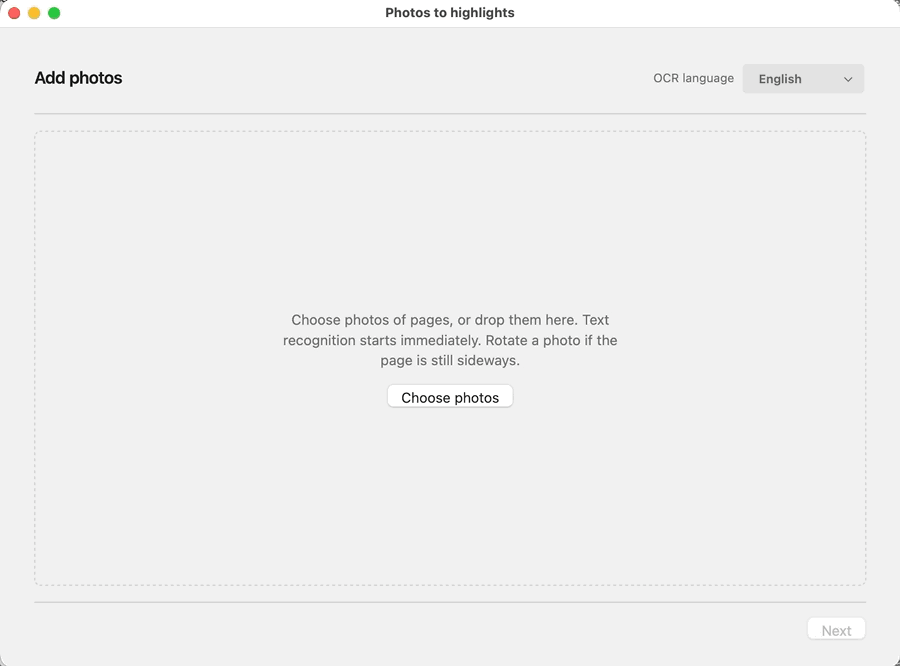

# Zotero Photo Highlights

Turn photos of physical pages into highlights on an item's PDF or EPUB in [Zotero](https://www.zotero.org/).

## Install

1. [Download the extension file (.xpi)](https://github.com/janbaykara/zotero-photo-highlights/releases/latest/download/zotero-photo-highlights.xpi).
2. In the Zotero menu bar, go to `Tools` → `Plugins` (or `Add-ons`)
3. Click the gear icon in the top right corner and select `Install Plugin From File...`
4. Select the downloaded `.xpi` file
5. (Ensure auto-updating is enabled for this add-on too!)
6. Restart Zotero!



## What gets saved

- **Text found in the file.** A highlight on that PDF or EPUB, dated when the photo was taken. The photo is deleted and is not imported.
- **Text not found.** Save an unlocated highlight, or skip and annotate in Reader later. **Keep the photo on the book** (off by default) also imports the picture, including when you skip.
- **Duplicate of an existing highlight.** Skip or create anyway. The photo is not kept.
- **Several plausible hits.** Each choice shows the words before and after that passage and, in a PDF, whether it sits near the top, middle, or bottom of the page. Pick one, then save. “None of these” treats it as unmatched.

Open the wizard from an item’s context menu or from Tools → Create highlights from photos. From an item, every photo stays on that book. From Tools, you choose the book for each photo. Each photo is turned upright from its camera orientation as soon as it is added, and text recognition starts then. On macOS that uses Apple Vision. If the selected language returns nothing, Vision tries once more with automatic language detection before Tesseract. On Windows it uses Windows OCR when that language pack is installed. Otherwise recognition uses the bundled Tesseract engine, which downloads extra languages the first time they are needed. The photo list shows which of those engines read each photo. Rotate a photo on that step if the page is still sideways; recognition runs again. You can remove a photo from the list before continuing. A photo kept on the book is stored in that orientation. Each photo shows when it was taken, and the saved highlight uses that date. On the mark step the photo fills the window, with the selected passage and highlight colour in a narrow column beside it. That column can rotate the photo or recognize the text again; either one clears the passage and reads the page again. Skip leaves that photo out when it is too hard to read. A photo you leave without a passage is skipped the same way. Drag through the words on each photo. Click the passage in the column to type it yourself when the recognized words are wrong. Leaving a photo starts the search in the book while you mark the next one. If it is still running, Matching up highlights puts the book title first, then the passage and photo number with a bar for how many photos are done, and under that a short note of the page it is scanning. The highlight follows the lines between the two ends of the drag and uses the annotation colour. Words around that selection are used to tell repeated sentences apart. If that text cannot be found, review shows the photo, when it was taken, and the start of the passage in its highlight colour, then what happened. You can save an unlocated highlight, skip, edit the quote, or choose the passage again. When several places match, review asks you to choose where to locate the passage, and each place is shown in full, two at a time. Save stays unavailable until a place is chosen. Edit quote, add a comment, and choose the passage again sit under the highlighted passage.

## Development

Requirements: Zotero 7 or later, Node 22, and pnpm 10 for development.

```bash
pnpm install
pnpm start
pnpm test
pnpm lint:check
pnpm build
```

Identity fields live in `package.json` `config` (`photo-highlights@janbaykara.com`). Architecture notes: [doc/TECHNICAL.md](doc/TECHNICAL.md).
